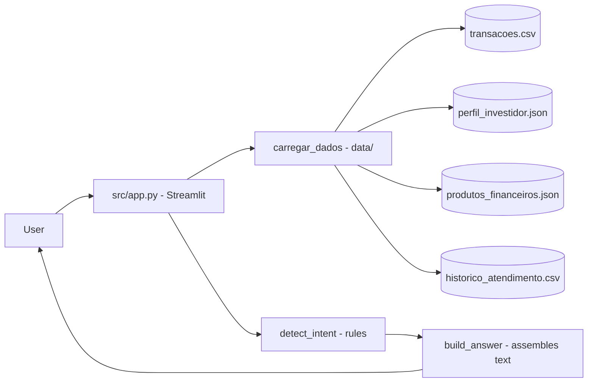

# BIA do Futuro — Intelligent Financial Assistant

**English** · [Português (Brasil)](README.md)

[](#) [](#) [](#) [](LICENSE)

## What it is

**BIA (Banco Inteligente Assistente)** is a financial agent that talks with the user about spending, investing, goals and money education. It is the submission for the **"BIA do Futuro"** challenge of the **DIO (Digital Innovation One)** bootcamp, which asks for an intelligent financial assistant using generative AI.

A note on the actual implementation: the delivered code is **rule-based**. The intent of the message is detected through keywords and the answer is built from local data, **without calling an LLM API** (`examples/README.md` carries the instructor's Gemini example, but the app does not consume it).

## Status

Bootcamp / educational laboratory project. Runs locally with Streamlit. No verified published deployment.

## Features

- **Chat with intent detection**: transaction, product, planning, education, greeting, comparison, simulation and general.
- **Spending analysis** by category and **monthly summary** from `transacoes.csv` (89 fictitious transactions).
- **Goal progress** computed against the investor profile.
- **Product recommendations** by risk profile (8 products in the catalog).
- **Educational content** on financial concepts (5 topics).
- **Quick questions** pre-defined and conversation history kept in `st.session_state`.
- **Educational disclaimer** in every answer: it is not an investment recommendation.

## Architecture

A single Streamlit application file (`src/app.py`) loads a local "knowledge base" in `data/` (CSV and JSON), detects the intent with rules and builds the answer in Python. The `docs/` folder holds the agent documentation (use case, prompts, metrics and pitch) and `examples/` brings the instructor's references.



## Stack

- Python 3.x
- Streamlit
- Pandas
- JSON (profile and product data)

## Repository layout

```
dio-lab-bia-do-futuro/
├── src/app.py              # Streamlit app (663 lines)
├── data/
│   ├── transacoes.csv              # 89 fictitious transactions
│   ├── perfil_investidor.json      # profile, goals and risk
│   ├── produtos_financeiros.json   # 8 products + 5 educational items
│   └── historico_atendimento.csv   # 12 previous sessions
├── docs/
│   ├── 01-documentacao-agente.md   # use case and problem
│   ├── 02-base-conhecimento.md     # data structure
│   ├── 03-prompts.md               # the agent's system prompt
│   ├── 04-metricas.md              # how to evaluate answers
│   └── 05-pitch.md                 # elevator pitch
├── examples/README.md      # instructor references and examples (DIO)
└── LICENSE                 # MIT
```

## Prerequisites and installation

```bash
pip install streamlit pandas
```

There is no `requirements.txt` in the repository.

## How to run

```bash
streamlit run src/app.py
```

The app opens in the browser at `http://localhost:8501`. It works locally and on Streamlit Cloud (data loading uses a relative path).

## Tests and quality

There are no automated tests in this repository (the absence of a test folder and of CI is confirmed). The interaction is validated manually through the chat flow.

## Technical decisions and trade-offs

- **Rule-based instead of calling an LLM**: the answer is deterministic, cheap and does not expose an API key. The trade-off is lacking the flexibility of a real generative model.
- **Local data in `data/`**: works offline and on Streamlit Cloud with no database, at the cost of being a fixed, fictitious set.
- **Pandas analysis**: spending by category and monthly summary are aggregated straight from the CSVs.

## Known limitations and roadmap

- Answers are limited to the mapped intents (they do not cover every possible question).
- The code does not integrate the Gemini API described in the challenge proposal; `examples/README.md` shows how it would.
- The data is fictitious and serves the laboratory, not production.

## Development process

A DIO bootcamp project, built by Kelvin Oliveira with support from orchestrated AI agents and reviewed by the author. The technical documentation (`docs/`) and the data structure are the author's.

## License and author

MIT — Copyright (c) 2026 Kelvin Rebelo de Oliveira.

**Author**: [Kelvin Oliveira](https://github.com/KelvinOliveiraCode) · [Portfolio](https://kelvinoliveiracode.github.io/portfolio/)
