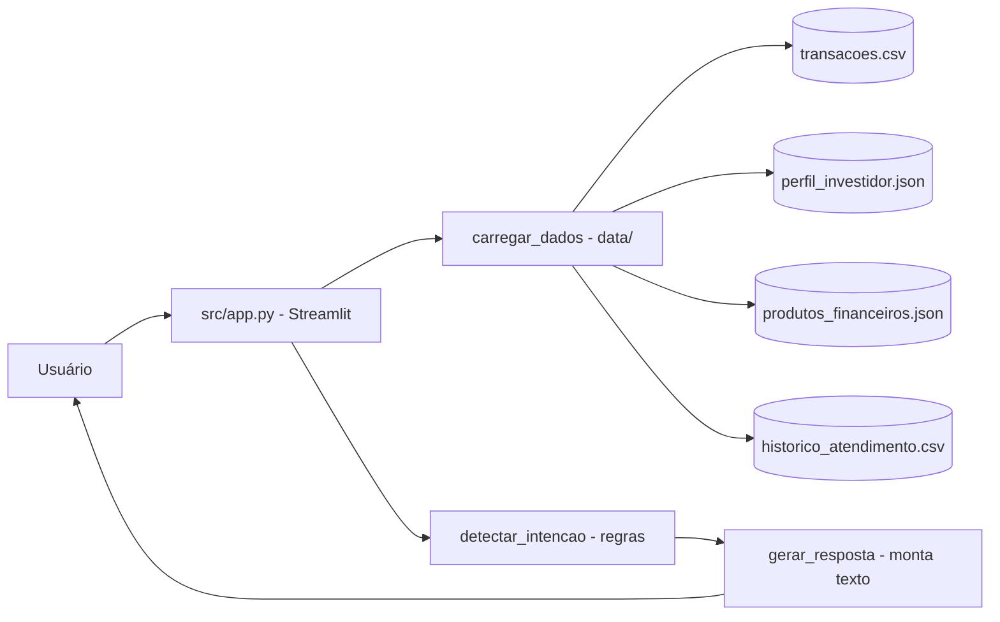

# BIA do Futuro — Assistente Financeiro Inteligente

[English](README.en.md) · **Português (Brasil)**

[](#) [](#) [](#) [](LICENSE)

## O que é

**BIA (Banco Inteligente Assistente)** é um agente financeiro que conversa com o usuário sobre gastos, investimentos, metas e educação financeira. É o projeto do desafio **"BIA do Futuro"** do bootcamp da **DIO (Digital Innovation One)**, que pede um assistente financeiro inteligente com IA generativa.

Atenção à natureza do código: a implementação entregue aqui é **baseada em regras** (rule-based). A intenção da mensagem é detectada por palavras-chave e a resposta é montada a partir dos dados locais, **sem chamada a uma API de LLM** (o `examples/README.md` traz o exemplo do instrutor com Gemini, mas o app não a consome).

## Status

Projeto de bootcamp / laboratório educacional. Funciona localmente com Streamlit. Sem deploy publicado verificado.

## Funcionalidades

- **Chat com detecção de intenção**: transação, produto, planejamento, educação, saudação, comparação, simulação e geral.
- **Análise de gastos** por categoria e **resumo mensal** a partir de `transacoes.csv` (89 transações fictícias).
- **Progresso de metas** calculado contra o perfil do investidor.
- **Recomendações de produtos** por perfil de risco (8 produtos no catálogo).
- **Conteúdo educacional** sobre conceitos financeiros (5 tópicos).
- **Perguntas rápidas** pré-definidas e histórico de conversa em `st.session_state`.
- **Disclaimer educacional** em toda resposta: não constitui recomendação de investimento.

## Arquitetura

Um único arquivo de aplicação Streamlit (`src/app.py`) que carrega uma "base de conhecimento" local em `data/` (CSV e JSON), detecta a intenção por regras e monta a resposta em Python. A pasta `docs/` guarda a documentação do agente (caso de uso, prompts, métricas e pitch) e `examples/` traz referências do instrutor.



## Stack

- Python 3.x
- Streamlit
- Pandas
- JSON (dados de perfil e produtos)

## Estrutura do repositório

```
dio-lab-bia-do-futuro/
├── src/app.py              # aplicação Streamlit (663 linhas)
├── data/
│   ├── transacoes.csv              # 89 transações fictícias
│   ├── perfil_investidor.json      # perfil, objetivos e risco
│   ├── produtos_financeiros.json   # 8 produtos + 5 conteúdos educacionais
│   └── historico_atendimento.csv   # 12 atendimentos anteriores
├── docs/
│   ├── 01-documentacao-agente.md   # caso de uso e problema
│   ├── 02-base-conhecimento.md     # estrutura dos dados
│   ├── 03-prompts.md               # system prompt do agente
│   ├── 04-metricas.md              # como avaliar respostas
│   └── 05-pitch.md                 # pitch de elevador
├── examples/README.md      # referências e exemplos do instrutor (DIO)
└── LICENSE                 # MIT
```

## Pré-requisitos e instalação

```bash
pip install streamlit pandas
```

Não há `requirements.txt` no repositório.

## Como executar

```bash
streamlit run src/app.py
```

O app abre no navegador em `http://localhost:8501`. Funciona local e no Streamlit Cloud (o carregamento de dados usa caminho relativo).

## Testes e qualidade

Não há testes automatizados neste repositório (ausência de pasta de testes e de CI confirmada). A interação é validada manualmente pelo fluxo do chat.

## Decisões técnicas e trade-offs

- **Rule-based em vez de chamar LLM**: a resposta é determinística, barata e não expõe chave de API. O trade-off é não ter a flexibilidade de um modelo generativo de verdade.
- **Dados locais em `data/`**: funciona offline e no Streamlit Cloud sem banco, ao custo de ser um conjunto fixo e fictício.
- **Análises com Pandas**: gastos por categoria e resumo mensal são agregados diretamente dos CSVs.

## Limitações conhecidas e roadmap

- As respostas são limitadas às intenções mapeadas (não cobre todas as perguntas possíveis).
- O código não integra a API Gemini descrita na proposta do desafio; o `examples/README.md` mostra como faria.
- Os dados são fictícios e servem ao laboratório, não a produção.

## Processo de desenvolvimento

Projeto de bootcamp da DIO, construído por Kelvin Oliveira com apoio de agentes de IA orquestrados e revisado pelo autor. A documentação técnica (`docs/`) e a estrutura de dados são do autor.

## Licença e autor

MIT — Copyright (c) 2026 Kelvin Rebelo de Oliveira.

**Autor**: [Kelvin Oliveira](https://github.com/KelvinOliveiraCode) · [Portfólio](https://kelvinoliveiracode.github.io/portfolio/)
